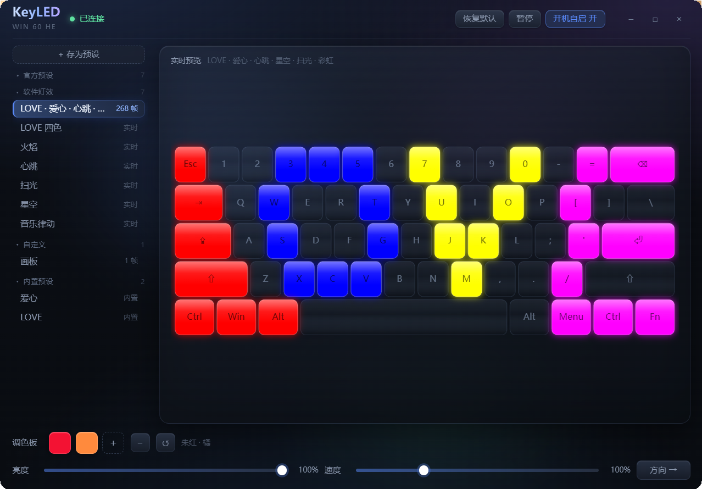
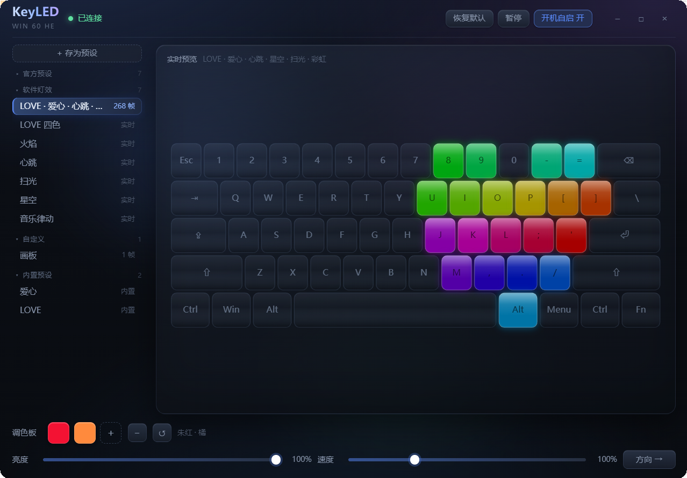

# KeyLED

[](LICENSE)


**给 AULA WIN 60 HE（61 键 60% 磁轴键盘）做的灯效控制程序。** 单文件、免安装，双击即用：15 种灯效、逐键画板、音乐律动。关掉窗口后驻留托盘，灯效持续运行。



## 目录

- [主要功能](#主要功能)
- [环境依赖](#环境依赖)
- [安装与运行](#安装与运行)
- [使用说明](#使用说明)
- [配置说明](#配置说明)
- [目录结构](#目录结构)
- [工作原理](#工作原理)
- [常见问题](#常见问题)
- [参与贡献](#参与贡献)
- [许可证](#许可证)

## 主要功能

| 分类 | 内容 |
|---|---|
| 灯效 | 15 种。官方预设 7 种：常亮、呼吸、彩虹、涟漪、光谱、雨滴、扫描；软件灯效 7 种：LOVE 动画、LOVE 四色、火焰、心跳、扫光、星空、音乐律动；另有逐键画板 |
| 画板 | 左键涂色、右键擦除，最多 600 帧，可逐帧编辑和播放；任何灯效或预设都能"烘焙"成固定帧，再串联或叠加到画板 |
| 预设 | 内置爱心、LOVE 两个手绘图案；可保存自己的预设，最多 60 个 |
| 调色板 | 每个灯效记住自己的 1 到 5 种颜色，互不干扰；内置 32 色面板和系统取色器 |
| 音乐律动 | 采集系统正在播放的声音，分成 16 段频谱，声音越大点亮的行数越多 |
| 控制 | 亮度、速度实时可调；可暂停；可设置开机自启 |
| 常驻 | 关闭窗口收进托盘，灯效继续运行；键盘断开后每 3 秒自动重连 |

LOVE 动画共 268 帧、26.8 秒，每一帧每个键的颜色都是预先录制的，所以它的点亮顺序无法更改。

## 环境依赖

| 项目 | 要求 |
|---|---|
| 操作系统 | Windows 10 或 Windows 11，64 位（实测 Windows 10 22H2） |
| 键盘 | AULA WIN 60 HE，61 键。程序通过 HID 接口 `VID_2E3C / PID_C365 / MI_02` 与键盘通信 |
| 直接运行 | 不需要其它依赖，不需要管理员权限，不需要联网 |
| 从源码运行 | Python 3.11 及以上（实测 3.13），以及 [requirements.txt](requirements.txt) 中的库 |

## 安装与运行

### 直接运行

1. 从 [Releases](https://github.com/Willoneday/KeyLED/releases/) 下载 `KeyLED.exe` 。仓库根目录的 `KeyLED.exe` 也可以直接使用。
2. 双击 `KeyLED.exe`。程序没有数字签名，首次运行若出现 Windows 安全提示，点"更多信息"，再点"仍要运行"。
3. 使用前请退出 A HUB，并关闭浏览器里打开的键盘网页。它们运行时会独占键盘，程序会显示"等待键盘"。

### 从源码运行

在仓库根目录执行：

```bat
pip install -r requirements.txt
python app/keyled.py
```

### 自行打包

```bat
app\build-exe.bat
```

脚本会安装依赖并调用 PyInstaller，把程序、界面和素材打成一个 `KeyLED.exe`，放在仓库根目录。

## 使用说明

### 界面

- **左侧栏**：单击切换灯效。右键灯效可把它"烘焙成帧"追加到画板。上方的"存为预设"保存当前整套设置；内置预设和"我的预设"单击应用，右键可追加、叠加到画板或删除。
- **中间**：实时预览，显示的正是推送到键盘的那一帧。画板模式下直接在键上左键涂色、右键擦除。
- **下方**：调色板，单击色块改色，`+` 和 `−` 增删颜色，`↺` 恢复当前灯效的默认配色；亮度、速度滑块；方向按钮反转彩虹和涟漪的流动方向。
- **顶部**：恢复默认、暂停或继续、开机自启；右上角最小化、最大化、关闭。关闭只是收进托盘，托盘菜单里才有"退出"。



画板模式下会多出一行帧工具：选择帧、播放或停止、在当前帧后插入一帧、删除当前帧、清空当前帧、清空全部帧。画板以每秒 8 帧乘以速度设置播放。

### 键盘固件自带的灯效

以下快捷键由键盘固件实现，不依赖本程序：

| 功能 | 按键 |
|---|---|
| 切换内置灯效 | `Fn + PgUp`（部分批次为 `Fn + 右 Alt`） |
| 更换灯效颜色 | `Fn + Del` |
| 亮度、速度 | `Fn + ↑ / ↓`、`Fn + ← / →` |
| 灯光开关 | `Fn + Ins`（部分批次为 `Fn + 空格`） |
| 恢复出厂 | 长按 `Fn + 空格` |

## 配置说明

配置和日志保存在 `%LOCALAPPDATA%\KeyLED\`：

| 文件 | 内容 |
|---|---|
| `config.json` | 当前状态：灯效、调色板、亮度速度、画板内容。每次修改后自动写入，也可以手动编辑 |
| `presets.json` | "我的预设"。每项是一份完整状态加上 `name`，最多 60 项 |
| `keyled.log` | 运行日志，超过 400 KB 自动重新开始 |

`config.json` 的字段：

| 字段 | 含义 | 取值 |
|---|---|---|
| `effect` | 当前灯效 | 灯效编号：`solid` `breath` `rainbow` `ripple` `spectrum` `raindrop` `scan` `love` `love4` `fire` `heart` `sweep` `star` `beat` `custom` |
| `colors` | 当前灯效使用的调色板 | 1 到 5 个 `#rrggbb` 颜色 |
| `palettes` | 各灯效分别保存的调色板 | 对象，键为灯效编号 |
| `speed` | 速度 | 0.25 到 3.0，对应界面的 25% 到 300% |
| `bright` | 亮度 | 0 到 1 |
| `dir` | 方向 | `1` 或 `-1` |
| `custom_frames` | 画板内容 | 数组，每帧 61 个 `#rrggbb`，最多 600 帧 |
| `frame`、`frame_play` | 画板的当前帧、是否播放 | 整数、布尔值 |

某个字段无法解析时，程序从该处停止读取，其后的字段使用默认值。颜色值无法识别时按黑色显示。

## 目录结构

```
KeyLED.exe                      成品，Windows 64 位，免安装
app/
  keyled.py                     全部逻辑：灯效引擎、HID 通信、配置、托盘、音频
  ui.html                       界面：布局、预览画布、交互
  love.bin                      内置 LOVE 动画
  arrow.png  hand.png  text.png 界面光标
  keyled.ico                    程序图标
  build-exe.bat                 一键打包脚本
docs/                           说明文档使用的截图
PROTOCOL.md                     键盘 HID 协议的逆向记录
requirements.txt                从源码运行所需的依赖
README.md
LICENSE
```

## 工作原理

灯效引擎运行在独立的 Python 线程里，不受窗口是否可见的影响。界面基于 WebView2，只负责绘制预览和发送指令。

键盘内部是一块 132 个灯槽乘以 RGB 共 396 字节的缓冲区，每个键对应其中一个灯槽。程序每帧把 61 个键的颜色铺进这块缓冲区，拆成 8 个 64 字节的 HID 报文写入键盘。报文之间需要留 4 毫秒间隔，所以帧率约为每秒 31 帧，瓶颈在通信而不在计算。写入的内容掉电后仍然保留。

协议的来源和细节见 [PROTOCOL.md](PROTOCOL.md)。

## 常见问题

**键盘没反应，标题栏显示"等待键盘"**
键盘被其它程序占用。退出 A HUB，关闭浏览器里打开的键盘网页，程序会在 3 秒内自动重连，不需要重启。

**音乐律动没反应**
程序采集的是系统默认输出设备正在播放的声音。看"实时预览"旁边的提示："没收到声音"表示当前没有声音在播放，"打不开音频设备"表示采集无法建立。切换输出设备后程序会自动重新采集。

**托盘图标找不到**
Windows 会把托盘图标折叠进任务栏右侧的 `^` 溢出区。

**关机以后灯效还会动吗**
不会。本程序是实时推送动画，程序退出后键盘停在最后一帧，这一帧掉电保留。想让键盘关机后继续动，需要使用固件自带的灯效，并且主板在关机状态下仍给 USB 口供电，通常要在 BIOS 里关闭 ErP。

**画板帧数多了会卡吗**
不会。渲染时只读取当前帧，600 帧时的计算量仍远小于键盘通信的开销。

## 参与贡献

- **报告问题**：请附上 `keyled.log`、键盘型号和 Windows 版本。
- **提交代码**：Fork 后新建分支，修改完成后发起 Pull Request。提交前请运行 `python app/keyled.py --selftest`，它会连接键盘并推送几帧测试画面。
- **约定**：
  - 程序保持 `app/keyled.py` 加 `app/ui.html` 两个文件的结构，不拆分成多个模块。
  - 灯效的数值就是灯效本身。改动灯效计算时请说明意图；如果只是整理代码，输出必须逐帧保持不变。
  - 配置文件是用户可见、可以手改的 JSON，字段和格式要保持向后兼容。
  - HID 报文之间的间隔必须在真键盘上验证后才能调整。
- **适配其它键盘**：需要重新标定键位与灯槽的对应表，并修改设备标识，方法见 [PROTOCOL.md](PROTOCOL.md)。

## 许可证

代码以 [MIT 许可证](LICENSE) 发布。

本项目是个人爱好作品，与键盘厂商无关。
